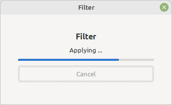

# Filter Progress

[Read Me](README.md) ● [Change Log](CHANGELOG.md)

A Gramps addon that shows a progress window with a working **Cancel** button while a filter runs.

## Why this addon is needed
A filter on a large Family Tree can take a long time, especially with a complex custom filter. Gramps itself does not let you stop a filter once it has started:
- **Gramps 5.2** shows a progress window while a filter runs, but the window has no Cancel button. The only way to stop a slow filter is to wait, or to close Gramps.
- **Gramps 6.0 and 6.1** show no progress window at all. The filter engine was rewritten for 6.0, and [the line that opens the progress window is commented out](https://github.com/gramps-project/gramps/blob/v6.0.8/gramps/gen/filters/_genericfilter.py#L190-L191) in the Gramps source (checked in Gramps 6.0.8, the 6.1 branch, and the development branch, as of October 2026). While a filter runs, Gramps looks frozen, with no sign of how far it has gotten and no way to stop it.

This addon fills that gap on both versions.

## What it does
Whenever a view applies a filter with progress reporting (for example, a search from the **Filter** sidebar gramplet or the **Flat Filter** gramplet), a small **Filter** window opens with a progress bar and a **Cancel** button.
- The bar shows how much of the Family Tree has been checked.
- **Cancel** stops the filter. The view then shows the people found up to that point. Nothing tells you that the list is incomplete, so run the filter again if you need the full result.
- The window closes by itself when the filter finishes.

On Gramps 6.0 and later, the bar moves in 100 steps, so redrawing the window does not slow down the filter on a large Family Tree. Cancel takes effect at the next step, so the filter can run a moment longer after you click it. While it stops, the window shows "Canceling...".

## About Cancel in Gramps
Many Gramps progress windows cannot be stopped. If you try to close one with the window close button or the Escape key, Gramps refuses and shows a warning titled "Attempt to force closing the dialog", with the message "Please do not force closing this important dialog." The task then keeps running. This happens for every progress window that Gramps opens without Cancel support, whether the task is important or not.

The progress window of this addon is opened with Cancel support. So the close button of the window does the same thing as **Cancel**, and that warning does not appear.

## Installation
1. Install **Filter Progress** with the Addon Manager.
2. Restart Gramps.

The addon has nothing to open or configure. It works as soon as Gramps restarts.

If an older copy is installed by hand, replace the whole `filterprogress` folder. Older copies had only a single `filterprogress.gpr.py` file.

## Turning it off
In the *Plugin Manager plus*, select **Filter Progress**, click **Deactivate**, and restart Gramps. (The **Hide** an equivalent action in the original or enhanced versions of the Plugin Manager.)  Filters will then behave as Gramps normally does.

## Compatibility
- Gramps 5.2, and Gramps 6.0.2 through 6.1.
- The registration allows versions up to 6.2. If a future Gramps restores its own progress window, check this addon again before you upgrade, because two progress windows could appear.

## Notes for developers
- The addon has two files. `filterprogress.gpr.py` only registers the plugin. `filterprogress.py` holds the code.
- The registration sets `load_on_reg=True`. Gramps imports `filterprogress.py` once at startup and calls its `load_on_reg()` function, which replaces methods of `gramps.gen.filters._genericfilter.GenericFilter`. Importing the module alone changes nothing.
- The replaced methods depend on the Gramps version: `check_func()` and `check_and()` on Gramps 5.2, and `apply_logical_op_to_all()` on Gramps 6.0.2 and later. Only methods that exist in the running Gramps are replaced. Any change to these methods in Gramps core needs a matching change here.
- Messages use the logger `.filterprogress`, never `print()`. Gramps writes each log line with its file name and line number. To see the debug messages (the number of people checked, and where a Cancel stopped the filter), start Gramps with `gramps -d ".filterprogress"`.
- In the Gramps source, restoring the commented-out `begin_progress()` call in `GenericFilter.apply_logical_op_to_all()`, together with a Cancel button, would make this addon unnecessary for that Gramps version.

## Credits
Original addon by Kari Kujansuu (kari.kujansuu@gmail.com), 2024.

Version 2.0.0 restructured by Claude AI (Anthropic), wish coding by Brian McCullough, 2026.

## License
GNU General Public License v2.0 or later, consistent with Gramps itself.
